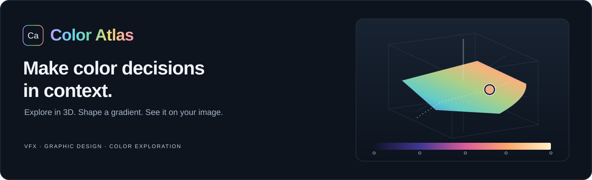

<p align="center">
  <a href="https://raffribeiro.github.io/ColorAtlas/">
    
  </a>
</p>

<p align="center">
  <strong>A visual color and gradient workspace for VFX artists and graphic designers.</strong><br>
  Explore perceptual color, build gradient maps and preview the result on layered images — directly in your browser.
</p>

<p align="center">
  <a href="https://raffribeiro.github.io/ColorAtlas/"><strong>Launch Color Atlas →</strong></a>
  &nbsp; · &nbsp; <a href="#get-started">Get started</a>
  &nbsp; · &nbsp; <a href="#use-it-offline">Use offline</a>
  &nbsp; · &nbsp; <a href="https://github.com/raffribeiro/ColorAtlas/issues/new?template=bug_report.yml">Feedback</a>
</p>

<p align="center">
  
  
  
  
</p>

[](https://raffribeiro.github.io/ColorAtlas/)

## From a color idea to a working palette

| Explore | Build | Preview |
| --- | --- | --- |
| Rotate the **OKLab color solid** and edit on a continuous lightness slice. Connect hue, chroma and lightness with the matching color wheel. | Place gradient keys, choose **Smooth or Bands**, undo edits and export a gradient PNG. | See your palette on an image. Stack layers, set blending and opacity, normalize values and adjust bloom. |

- **Start with inspiration.** Browse **1,086 built-in palette presets**, save your own or try guided Random modes, including Graphic Design — Smooth and Bands.
- **Learn as you work.** A guided tutorial, contextual help and interactive Documentation explain the controls inside the app.
- **Choose your language.** English, Português (Brasil), Español, Français, Deutsch, Italiano, 日本語, 한국어 and 简体中文. English is the default.

The 3D layout is inspired by **Munsell's color tree**; the main editor uses **OKLab** for its color calculations.

## Get started

**[Open Color Atlas in your browser →](https://raffribeiro.github.io/ColorAtlas/)**
No installation or app account required.

1. **Pick a starting point.** Choose a palette in the library or explore the default image preview.
2. **Shape the color.** Select a gradient key and edit it with the 3D view, color wheel or sliders.
3. **See it in context.** Watch the Preview, then save your palette or export your result.

Open **Tutorial** for a walkthrough or **Documentation** for interactive examples. Both are in the top bar, beside the language menu.

### Use it offline

[Download the repository ZIP](https://github.com/raffribeiro/ColorAtlas/archive/refs/heads/main.zip), extract it and open **`App/COLOR_ATLAS_START_HERE.html`** in your browser. You can also clone this repository. The delivered app includes its assets and needs no server or runtime dependency installation.

### Your workspace

Workspaces are stored locally in the browser profile for the address you use. **The online site and the offline HTML file have separate workspaces.** They do not automatically sync across devices or browsers. Use the app's **Export/Import** controls to back up or transfer supported data; keep exported copies of work you want to preserve.

## Inside the repository

| Location | What you will find |
| --- | --- |
| [`App/`](App/) | Ready-to-run offline app |
| [`Source/`](Source/) | Editable modules, canonical HTML snapshot, translations, documentation, build tools and tests |
| [`Source/docs/ARCHITECTURE.md`](Source/docs/ARCHITECTURE.md) | Source ownership and runtime contracts |
| [`Realase/CHANGELOG.md`](Realase/CHANGELOG.md) | Release history (`Realase` is the existing folder name) |
| [`GITHUB.md`](GITHUB.md) | Repository setup and website publication procedure |

<details>
<summary><strong>Development and publication</strong></summary>

Read [`Source/README.md`](Source/README.md), [`Source/AGENTS.md`](Source/AGENTS.md) and the [architecture map](Source/docs/ARCHITECTURE.md) before editing. Change the owning source module, then regenerate the distribution.

Build the included source snapshot:

```sh
cd Source
python3 work/build_standalone.py canonical/munsell-selector.html
```

Output: `Source/outputs/munsell-color-picker.html`. Some installers, packaging tools and tests retain paths or tooling dependencies from the original macOS workspace. Read the [setup notes](GITHUB.md) before running them elsewhere.

| Branch | Purpose |
| --- | --- |
| `develop` | Work in progress and builds for review |
| `main` | Approved source and distribution |
| `release` | Distribution history |
| `gh-pages` | Published website files |

Changes are reviewed before release. The owner's explicit approval is required to publish a validated snapshot on `gh-pages`; pushes to `develop` or `main` do not automatically publish the app.

</details>

## Feedback and security

- **Something broken?** [Report a bug](https://github.com/raffribeiro/ColorAtlas/issues/new?template=bug_report.yml) with your browser, operating system and steps to reproduce.
- **Have an idea?** [Suggest a feature](https://github.com/raffribeiro/ColorAtlas/issues/new?template=feature_request.yml).
- **Found a vulnerability?** Follow the [security reporting policy](.github/SECURITY.md) to report it privately.

---

Created by **Raff Ribeiro**.
