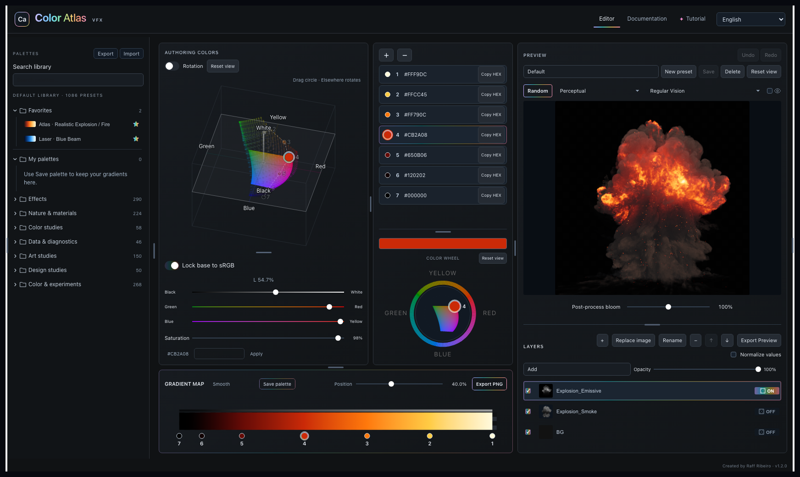

<div align="center">

# Color Atlas

**Explore color. Build gradients. See them in context.**

A browser-based color and gradient workspace for VFX and graphic design, with an interactive OKLab color solid, layered image previews and a built-in learning guide.

[**Launch Color Atlas →**](https://raffribeiro.github.io/ColorAtlas/) · [Report a bug](https://github.com/raffribeiro/ColorAtlas/issues/new?template=bug_report.yml) · [Suggest a feature](https://github.com/raffribeiro/ColorAtlas/issues/new?template=feature_request.yml)


</div>

[](https://raffribeiro.github.io/ColorAtlas/)

## A workspace for color decisions

Explore a color in 3D, shape its gradient and immediately see how it changes an image. Color Atlas combines color authoring, palette exploration and visual learning in one workspace.

- **Explore color in 3D.** Rotate the OKLab color solid and edit colors on a continuous lightness slice. A matching color wheel connects hue, chroma and lightness.
- **Build gradient maps.** Place color keys, switch between Smooth and Bands, undo edits and export a gradient PNG.
- **Preview in context.** Import images, stack layers, adjust blending and opacity, normalize values per layer and inspect post-process bloom.
- **Find a starting point.** Browse 1,086 built-in palette presets, save your own palettes, or explore guided Random modes, including Graphic Design — Smooth and Bands.
- **Learn while creating.** Follow the onboarding, pause over controls for contextual help, and explore interactive examples in Documentation.
- **Work in your language.** English, Português (Brasil), Español, Français, Deutsch, Italiano, 日本語, 한국어 and 简体中文. English is the default.

The 3D view takes its organizing inspiration from Munsell's color tree; the main editor's color calculations use **OKLab**.

## Try it

**[Open the online app](https://raffribeiro.github.io/ColorAtlas/)** — no installation or account required to use the app.

1. Choose a palette from the library or start with the default preview.
2. Select a gradient key and adjust it with the 3D view, wheel or sliders.
3. Watch the Preview, then save your palette or export your result.

Open **Tutorial** for a guided walkthrough or **Documentation** for interactive explanations. The language menu is in the top bar.

### Use it offline

Download or clone this repository and open [`App/COLOR_ATLAS_START_HERE.html`](App/COLOR_ATLAS_START_HERE.html) in your browser. The delivered app is self-contained and does not require a server or a runtime dependency installation.

Your workspace is saved in the browser profile for the address you use. The online site and a local HTML file have separate workspaces. Use the app's Export/Import controls to back up or transfer supported data.

## Project layout

| Path / branch | Purpose |
| --- | --- |
| [`App/`](App/) | Runnable offline distribution |
| [`Source/`](Source/) | Development modules, canonical HTML snapshot, translations, guide, build tools and tests |
| [`Source/docs/ARCHITECTURE.md`](Source/docs/ARCHITECTURE.md) | Source ownership and runtime contracts |
| [`Realase/CHANGELOG.md`](Realase/CHANGELOG.md) | Release history; `Realase` is the existing folder name |
| [`GITHUB.md`](GITHUB.md) | Repository setup, build caveats and website update procedure |
| `develop` | Work in progress and builds for review |
| `main` | Approved distribution and source |
| `release` | Distribution history |
| `gh-pages` | Published website files |

## Development

Read [`Source/README.md`](Source/README.md), [`Source/AGENTS.md`](Source/AGENTS.md) and the architecture map before changing the app. Editable modules and generated distribution files have different owners; don't patch generated HTML as a substitute for editing its source.

Build the included source snapshot:

```sh
cd Source
python3 work/build_standalone.py canonical/munsell-selector.html
```

The generated page is `Source/outputs/munsell-color-picker.html`. Some installers, packaging scripts and tests retain paths and tooling dependencies from the original macOS workspace; see [setup notes](GITHUB.md) before using them on another machine.

Changes are prepared on `develop` and reviewed before release. Website publication requires the owner's explicit approval and uses a validated snapshot on `gh-pages`; commits to `develop` or `main` do not automatically update the live app.

## Feedback

Found a problem? [Report a bug](https://github.com/raffribeiro/ColorAtlas/issues/new?template=bug_report.yml) with your browser, operating system, steps to reproduce and expected result. For ideas, [open a feature request](https://github.com/raffribeiro/ColorAtlas/issues/new?template=feature_request.yml).

---

Created by **Raff Ribeiro**.
